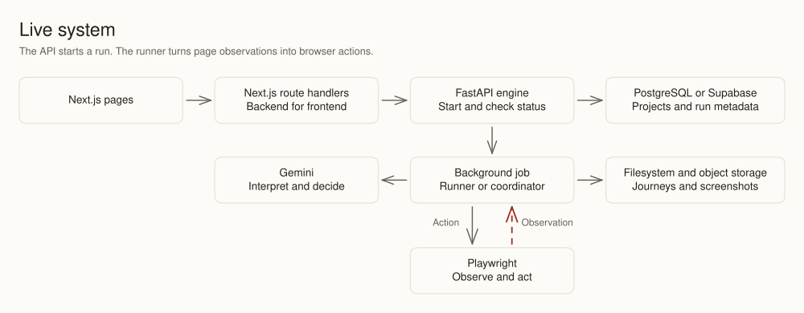

<h1 align="center">Sparrow Engineering</h1>

AI personas that test product journeys, from usability simulation on design prototypes to autonomous exploratory testing of live web apps (2025–2026).

Sparrow was for teams who wanted early signals on where users might struggle in a flow. We turned a task or exploration brief into a report with the screens visited, the actions taken, and the evidence behind a result. The reports gave teams a starting point for inspecting friction in a design flow or reproducing an issue in a running app.

Built with a small team. I built the simulation and exploration engine and its APIs.

<picture>
  <source media="(prefers-color-scheme: dark)" srcset="diagrams/live-system-dark.svg">
  
</picture>

The UI starts a run through FastAPI and reads the results from browser execution.

[Editable: live-system.excalidraw](diagrams/live-system.excalidraw)

## At a glance

Includes internal test runs.

| Runs | Discovered states | Tested transitions | Queued actions |
|---:|---:|---:|---:|
| 292[^runs] | 1,521[^states] | 11,076[^transitions] | 70,473[^queue] |

## Engineering highlights

- **Persona model.** TEA exposed the simulated decision, emotion, and action. OCEAN traits shaped behavior such as persistence and backtracking.
- **Design pipeline.** LangGraph connected screen parsing, route construction, persona turns, a success judge, and a UX audit.
- **Browser action grounding.** The runner mapped model-chosen intents to controls extracted from the current DOM.
- **Parallel exploration.** Browser agents claimed shared work. The coordinator added agents when the pending queue grew.
- **Evaluation.** Explicit assertions checked browser state. Heuristics inferred completion where applicable, and behavioral signals ranked problem screens.

## How it evolved

- **August 2025.** We simulated a persona moving through design screens and recorded a Thought–Emotion–Action (TEA) trace for each journey.
- **September–October 2025.** We developed graph-based traversal with OCEAN personality traits and carried the persona loop into a live browser.
- **November–December 2025.** We added autonomous exploration with Playwright, a shared work queue, and a graph of states and transitions discovered during a run.

**Stack** Next.js, FastAPI, LangGraph, Gemini, Playwright, PostgreSQL, and Supabase.

## Engineering docs

| Doc | What it covers |
|---|---|
| [System architecture](docs/system-architecture.md) | execution, persistence, and the data model. |
| [Screen understanding and navigation](docs/screen-understanding-and-navigation.md) | screen parsing, route construction, and live observations. |
| [Persona simulation](docs/persona-simulation.md) | traits, TEA traces, and UX audits. |
| [Autonomous exploratory testing](docs/autonomous-exploratory-testing.md) | adaptive navigation and shared browser work. |
| [Agent execution and evaluation](docs/agent-execution-and-evaluation.md) | task checks, findings, and scoring. |
| [Why we pivoted and what we learned](docs/why-we-pivoted-and-learnings.md) | the shift from design simulation to live exploration. |

## Glossary

- **TEA** Thought–Emotion–Action. The persona’s intent, modeled emotion, and chosen action.
- **OCEAN** Openness, conscientiousness, extraversion, agreeableness, and neuroticism.
- **BFF** Backend for frontend. The route handlers that connect the UI to the engine.

**Status** Wound down in March 2026.

Docs only. Source is private. The documentation is licensed under [CC BY 4.0](LICENSE).

[^runs]: Count of data rows in the `runs` table.
[^states]: Sum of nonnegative `total_states` values in `exploratory_metrics`. States are counted per run.
[^transitions]: Sum of nonnegative `total_transitions` values in `exploratory_metrics`.
[^queue]: Count of data rows in `exploratory_work_queue` across all statuses.
