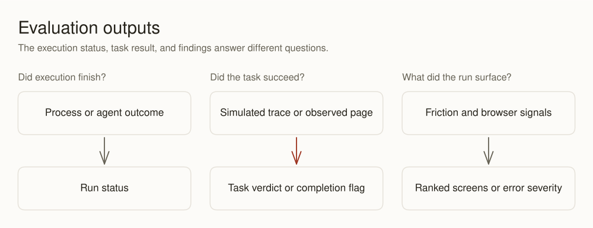
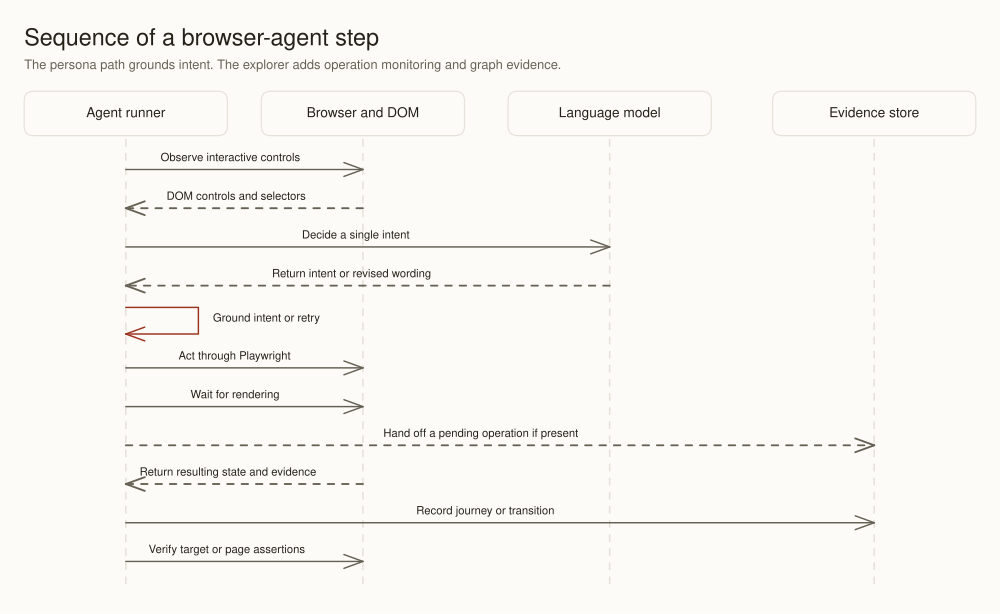
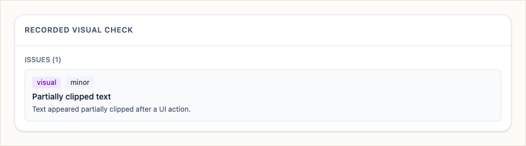

# Agent execution and evaluation

> [!NOTE]
> A browser step went from observation and intent to action, evidence, and verification.<br>
> Run status, task completion, and findings answered different questions.

## What a run needed to report

We needed to explain whether the engine finished the run, whether the agent completed the task, and what the journey surfaced. A failed click belongs in the journey even if the job finishes normally. A completed job still needs evidence for any claim that the task succeeded.

## Architecture and end-to-end flow

FastAPI marked the run in progress and scheduled execution. The persona runner recorded actions and produced a journey with a completion flag. The prototype evaluated a task from the simulated trace. The live persona runner evaluated completion against an observed browser state.

Exploratory runs recorded states and transitions, then aggregated agent outcomes and coverage across the run.

<picture>
  <source media="(prefers-color-scheme: dark)" srcset="../diagrams/evaluation-outputs-dark.svg">
  
</picture>

Execution status, task completion, and findings each answer a different question.

[Editable: evaluation-outputs.excalidraw](../diagrams/evaluation-outputs.excalidraw)

## Deep dive: one agent step

A browser step links a model’s suggestion to something the test actually observed. The persona runner exposed the intent and grounding decisions. The explorer stored browser transitions and evidence. The sequence combines those two paths to show where each stage contributed.

<picture>
  <source media="(prefers-color-scheme: dark)" srcset="../diagrams/browser-agent-step-dark.svg">
  
</picture>

The persona runner grounds intent and checks task completion. The exploration runner adds pending-operation handling and transition evidence.

[Editable: browser-agent-step.excalidraw](../diagrams/browser-agent-step.excalidraw)

### Observe, decide, and ground

We read the page, asked the model what to do next, and matched its answer to a control.

The persona extractor queried the live DOM for buttons, links, inputs, text areas, selects, and controls marked with roles or interaction attributes. It skipped hidden controls and controls with no visible size. For each remaining control, it kept the visible text, attributes, type, bounds, and a selector.

To choose a selector, it tried the element ID, a test ID, an ARIA label, and then a name. It could also use the input type and position or a short path through the element’s ancestors. Repeated labels and changes in element order could still make selectors ambiguous or stale.

We asked the model for one action in plain English. The first request gave it the task, page context, recent actions, and any supplied persona while withholding the list of controls. The matcher scored controls by text and identifying attributes. It gave more weight to control types that fit the request.

When strict matching failed, the runner recorded the miss and asked the model to rephrase. On later attempts, it tried a looser match if strict matching still failed. If those attempts failed, the runner showed the model the controls and asked it to choose one by its identifier. The runner marked this fallback as friction in the trace.

### Act, wait, and record

The runner performed the action, waited for the page to respond, and recorded what it observed.

Playwright used the matched selector to click or fill a control. The persona runner used short pauses and limited how long it waited for the page to load. The explorer scrolled controls into view, waited for them to become visible, and sometimes retried with a forced click. It could also select form options.

In sequential exploration, the runner checked for common loading indicators and status text. In queue mode, a button click that appeared to start a long operation could create a pending-operation record. The runner finished the work item, and a monitor revisited the page to check for completion, failure, or timeout.

The explorer recorded the starting state, the resulting state, the attempted action, and whether the browser executed it successfully. It took a screenshot of the resulting state. The DOM extractor listened for fetch and XHR requests and responses, plus console warnings and errors.

The transition writer saved console observations and linked network records to the transition by its identifier. Observing the page cleared the extractor’s event buffers. Some paths read the buffers after they were cleared, so the record could miss events or assign them to the wrong step.

<details>
<summary>Pseudocode</summary>

```text
page = observe visible controls and selector candidates
intent = ask for one action using task and page context
choice = ground intent, retrying with rephrasing and looser matching
if no grounded match: choose from the visible control list
if choice declares task done: return the current step's assertion result
outcome = perform the chosen browser action
if a long operation is detected: hand off and leave this step
wait for rendering, then observe the page and capture evidence
record the journey step or graph transition
check target conditions when evaluating the new state
```

</details>

### Verify outcomes and handle intermittent failures

We checked whether the page met the test conditions and looked for signs that the run was stuck.

When the model declared completion, the persona runner checked the current page. It looked for the expected fragment of the page address. It checked for required strings in the extracted element text and made sure excluded strings were absent.

The explorer marked states that met its configured target conditions as it discovered them. A successful click showed that the browser carried out the interaction. Task verification depended on what the page showed afterward.

The persona runner could stop a run that was still making progress at the same address. The explorer looked for repeated states and cycles, then changed what it explored when it detected a loop. Rephrasing helped it find some controls, and waits helped absorb changes in timing.

Controls still moved or disappeared between observation and action. A loading indicator could outlast the wait or clear before the content settled. Investigating a reported issue still required replaying the interaction and checking the result.

## Task judgments and findings

We implemented completion checks for an expected address substring, required visible text, and excluded text. When the agent declared completion, the runner applied the supplied checks to the current page. A heuristic inferred completion from goal words in the address or title when the request omitted both an expected address and required text.

The API set the persona job's terminal status from the process exit. The explorer set run status from the agent outcomes and reported partial failure when some agents failed.

### Example finding

In a staging run, the visual checker flagged partially clipped text after a UI action. The finding records the rendering symptom, and its associated test case supplies the interaction to replay. We'd repeat that action at the same viewport and check whether the text remains readable.



Sparrow’s findings panel, rendered locally with the scrubbed staging issue from this example.

## Ranking and classifying findings

> [!IMPORTANT]
> Execution status, task completion, and findings each answer a different question.

| Option | Pros | Cons | Decision |
|---|---|---|---|
| Problem-screen ranking | Used drop-offs, backtracking, automatic waits, loops, and dwell. Per-entry counts accounted for visit frequency. | The ranking reflects behavior recorded in the journey. | Used in persona analytics. |
| Recommendation themes | Classified recommendations by theme. | Needed a rule-based fallback for classification. | The fallback used severity and frequency. |
| Exploration evidence | Classified visual and browser signals by severity and counted states, transitions, and work completed. | Complete coverage needs a separate inventory of behaviors. | Used for exploration reports. |

The database contains 3,476 visual test cases and 6,038 visual test issue records, including internal test runs.[^visual]

## Where judgments could go wrong

The same page address sometimes hosted several intermediate states. The repeated-address guard treated enough repetitions as a stuck run, even when controls changed after an action. Conversely, matching goal words in a title gave the heuristic a way to infer success from text that might be incidental.

The explorer recorded issues when it observed symptoms. A single observation leaves the reproduction step open.

## What the results measure

The persona runner checked elapsed time between steps, so a slow browser action or model call extended a step. The coordinator bounded its wait for scheduled agents. The resulting counts describe what the system recorded during its runs. Complete product coverage requires a separate inventory of behaviors to exercise.

Our per-run timing columns were never populated, so we couldn't analyse step latency — we'd instrument model time, browser time and waits per step.

## What we'd do differently today

We'd require explicit checks for a verified outcome and label heuristic completion in the report. We'd save the observed state and expected outcome with each finding, then replay the sequence before classifying it as a reproducible defect. We'd also log per-run model usage and record browser time and retries alongside the journey.

[^visual]: Counts of data rows in `visual_test_cases` and `visual_test_issues`. A test case may have several issue records.

[← Previous](autonomous-exploratory-testing.md) · [README](../README.md) · [Next →](why-we-pivoted-and-learnings.md)
