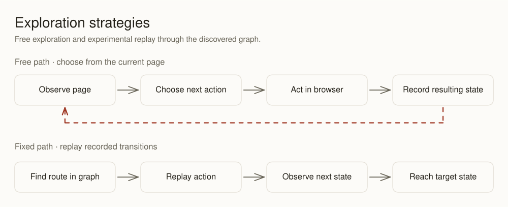
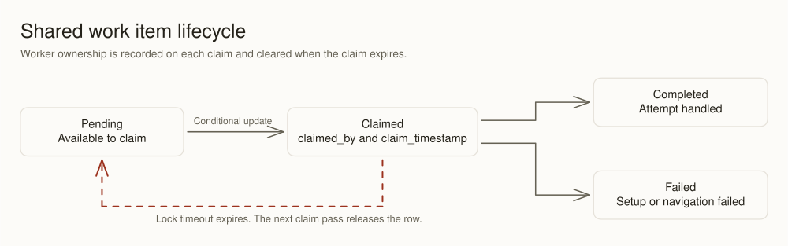
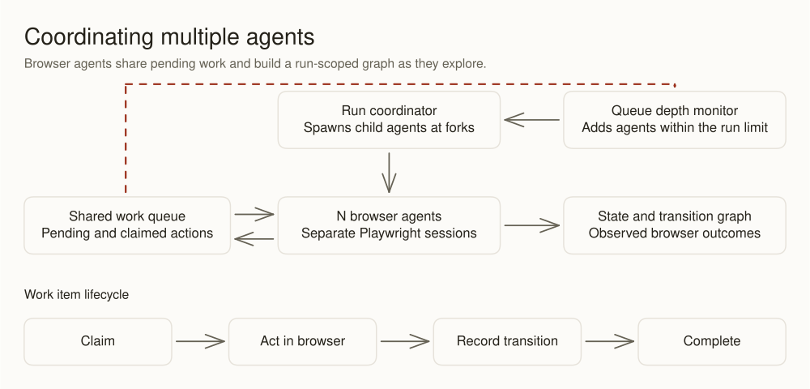
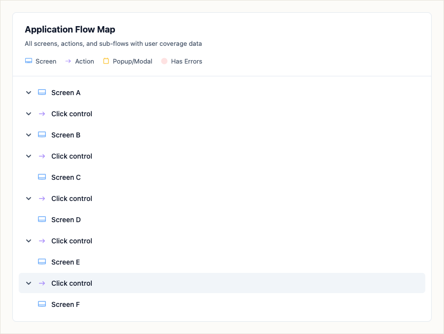

# Autonomous exploratory testing

> [!NOTE]
> Browser agents discovered states and transitions by choosing actions on the current page.<br>
> A shared work queue distributed actions, and recorded routes let agents return to known states.

## What live exploration needed

We built an explorer to find states that a predefined route would miss. A live app changes as someone works through it, so the runner needed to make its next decision from the page in front of it. We also needed a way to divide work across browsers and retain the sequence of actions that produced each observation.

## Architecture and end-to-end flow

The free-path persona runner observed the page, formed an intent, matched that intent to a current DOM control, and acted through Playwright. It then observed the resulting state and repeated the loop. The explorer added a coordinator and shared database state.

With a single agent, the runner asked the model for another action after each observation. In parallel mode, agents claimed actions from a shared queue and added discoveries to a run-scoped graph.

<picture>
  <source media="(prefers-color-scheme: dark)" srcset="../diagrams/exploration-strategies-dark.svg">
  
</picture>

Free exploration chooses actions from the current page. The experimental fixed-path mode replays recorded transitions toward a target state.

[Editable: exploration-strategies.excalidraw](../diagrams/exploration-strategies.excalidraw)

## Deep dive: the shared work queue

### Claiming and finishing an item

The queue tracked who took each item and how the attempt ended.

Agents shared one database table for the run. Each item stored the action, the state where it was available, its priority, and its status. The state let agents find work they could do from their current page. If an item belonged to another state, the agent tried to reach it before acting.

<picture>
  <source media="(prefers-color-scheme: dark)" srcset="../diagrams/shared-work-item-lifecycle-dark.svg">
  
</picture>

A claim reserves pending work until the agent finishes it or a later claim pass releases the expired reservation.

[Editable: shared-work-item-lifecycle.excalidraw](../diagrams/shared-work-item-lifecycle.excalidraw)

Before looking for work, the runner reset expired claims for the run. It put those items back in the pending list and cleared `claimed_by` and `claim_timestamp`. It read candidate rows, then tried a separate update that matched the item ID and required `status = 'pending'`.

The update saved the agent ID and claim time. If the database returned a row, the claim succeeded. The runner held no lock between reading and updating, so two agents could read the same pending item. The first update changed its status, so the other update skipped it. If another agent took the run-wide candidate first, the runner looked again.

The runner marked certain setup and navigation errors as failed. If a browser action returned failure, the runner recorded a failed transition and still marked the item complete. Complete meant the runner had handled the attempt. The runner could also complete an item by handing a long operation to the monitor.

### Depth before breadth

The scheduler looked for actions on the current page before searching the rest of the run.

It read up to ten items from that page, putting higher priorities first and breaking ties by age. With a positive depth threshold, it skipped ordinary navigation links until agents had claimed or completed enough functional actions on that page. It treated links with words such as “Save” or “Edit” as functional.

Sign-in and registration links stayed eligible so agents could reach the page they needed. The scheduler counted an action as soon as an agent claimed it, even if it was still running.

If it found no item to claim on the current page, the runner picked the highest-priority pending item from the whole run, again breaking ties by age. The fallback skipped the depth check. The exhaustive runner still searched the current page first. It set the threshold to zero so ordinary navigation links were eligible right away.

<details>
<summary>Pseudocode</summary>

```text
release expired claims for this run
local = pending work on this state, ordered by priority then age
depth = count claimed or completed functional items on this state
for item in the bounded local batch:
    if below depth threshold and item is ordinary navigation: continue
    if update_pending_item(item, agent, claim_time) changed a row: return item
item = first pending item across the run by priority then age
if item is absent: return no work
if update_pending_item(item, agent, claim_time) changed a row: return item
retry the claim
```

</details>

### State identity and retries

The state ID told agents where to act, and claim expiry let another agent retry unfinished work.

We built the state ID from a normalized address, a hash of a semantic DOM snapshot, and a separate hash of form values when present. We removed known transient parameters and the fragment from the address.

The DOM summary used the title and the types, roles, and text of interactive elements. It kept extra attributes for inputs. An ID that groups too much can confuse an empty form with a filled one and send an agent to the wrong state. An ID that distinguishes too much can turn small text or input changes into extra states and extra work.

As long as agents kept polling, they could reclaim expired work and run an action again. That could happen if the first agent stopped after acting or if it kept running past the timeout. On the normal path, the runner saved the resulting state and transition before updating the item’s status.

The runner saved the transition, attached network details, and updated the queue in separate database calls. Before adding work, it checked for recent duplicates and prior successful transitions. It wrote new items separately from that check. A crash or overlapping attempts could leave duplicate transitions or a completed item without its evidence.

Completion and failure updates matched the item ID alone. An agent with an expired claim could overwrite a newer claim.

### Scaling and alternatives

The coordinator added agents to handle a growing queue or to explore separate branches.

With auto-scaling enabled, the coordinator counted pending items. It added workers when the count reached the threshold, within the run’s agent limit. It stopped adding workers when its agent list reached that limit.

At branch points with enough distinct actions, it could start a child agent within the depth and pool limits.

> [!IMPORTANT]
> Keeping the queue with the graph made a run’s work and observations easy to inspect together.

| Option | Pros | Cons | Decision |
|---|---|---|---|
| Database table | Work and graph evidence shared the same database. | Idle polling produced reads, and busy workers contended for candidates. | Used by Sparrow. |
| Redis Streams or SQS | Would move delivery and reclamation into a dedicated queue. | Would still need to coordinate acknowledgments with graph writes and preserve page locality. | Retrospective alternative. |

We'd keep the table initially. We'd select and claim an item in one short transaction using `FOR UPDATE SKIP LOCKED`. Other agents could skip rows that someone was already claiming.

We'd check that the claim was still current before saving results. We'd write the transition and final queue status in one transaction and reuse the same identifier when retrying. The browser action would stay outside that transaction, so whether it was safe to repeat would still depend on the action.

## Building and coordinating exploration

We derived a state identifier from the normalized page address and a semantic representation of the DOM, with form values also available to identify distinct states. Work items associate actions with a state.

The runner prioritizes work on the current page, records transitions between observations, and makes new actions available as it discovers controls. The engine exposes the graph through a flow-tree endpoint so the UI can display how the run reached a state.

### Coordinating multiple agents

The coordinator starts a bootstrap browser. When followers need a session, they start from the bootstrap session state. In queue mode each agent claims work, acts in its browser, records the transition, and completes the work item. If a claim expires, the queue makes it available again.

When auto-scaling is enabled, the coordinator checks pending work and active agents and adds browsers subject to the run's agent limit. At branch points, the coordinator also spawned child agents to try alternate actions. It checked the exploration depth, the number of branches, and capacity in the agent pool before launching a child.

<picture>
  <source media="(prefers-color-scheme: dark)" srcset="../diagrams/multi-agent-exploration-dark.svg">
  
</picture>

Agents share work and record transitions. The coordinator responds to queue depth and branch points.

[Editable: multi-agent-exploration.excalidraw](../diagrams/multi-agent-exploration.excalidraw)



Sparrow’s flow map, rendered locally from screened staging data with anonymized screen labels and coverage figures removed.

Across all projects, including internal test runs, the database contains 70,473 work items and 1,308 agent-run records.[^work]

## Adaptive exploration and known routes

| Option | Pros | Cons | Decision |
|---|---|---|---|
| Free exploration | Chose actions from the current page and added new routes to the graph. | Spent part of a run discovering states and controls. | Used for live discovery. |
| Fixed-path replay | Searched successful transitions for a route to a target state, then replayed the actions in order. | Depended on previously recorded routes. | Experimental. It never shipped. |

## When exploration got stuck

Long-running actions sometimes left the browser in a transient state. The runner waited for loading and pending operations, detected repeated states, and attempted to recover from loops. If session setup for followers timed out, the coordinator continued with the bootstrap browser.

Failed selectors and outstanding claims left some work unfinished at the end of a run.

## What limited coverage

Coverage depends on what the browser exposes, how the runner distinguishes states, and the execution budget. Several browsers may share application-side state even when they have separate browser contexts. A fixed route is easier to rerun.

An adaptive run spends some effort discovering state and locating controls before it reaches a reproducible sequence.

## What we'd do differently today

We'd store a replayable journey with explicit checkpoints for each candidate finding and publish it once it reproduces. We'd isolate test data by browser where the app supports it and track the work left in the queue when a run ends.

[^work]: Counts of data rows in `exploratory_work_queue` and `exploratory_agent_metrics`. An agent-run record is a stored observation of an agent in an exploration run.

[← Previous](persona-simulation.md) · [README](../README.md) · [Next →](agent-execution-and-evaluation.md)
