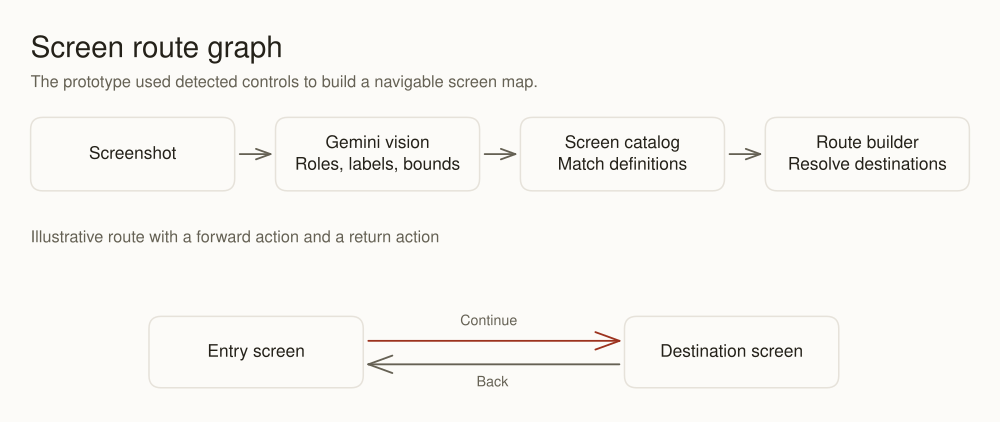

# Screen understanding and navigation

> [!NOTE]
> The prototype used vision to build a route map from design screens. 
> The live runner grounded its actions in controls it extracted from the DOM.

## From design screens to usable actions

The simulator needed to turn design screens into an environment a persona could navigate. It needed to identify controls, establish which design screen each image represented, and determine where each action led. A control label explains what a persona sees. A destination explains what the system observes after an action.

Keeping both in the route map let the simulator reason about a journey using the same screen descriptions throughout a run.

## Architecture and end-to-end flow

Gemini vision parsed screenshots into descriptions of screens and elements. The vision node recorded each control's role, visible text, confidence, and normalized bounds. The catalog matched detections to the supplied screen definitions.

The route builder chose an entry screen, listed actions for each screen, and resolved destination screens where it had sufficient input. The TEA loop read that route map to choose an action and advance its current screen.

<picture>
  <source media="(prefers-color-scheme: dark)" srcset="../diagrams/screen-route-graph-dark.svg">
  
</picture>

The route builder turns matched screens and their controls into a directed navigation map.

[Editable: screen-route-graph.excalidraw](../diagrams/screen-route-graph.excalidraw)

## Matching screens and grounding actions

The vision node expected structured JSON and attempted to recover malformed replies. The screen catalog made semantic matches between the detected and supplied screens. If it found no valid match, it fell back to pairing screens in their input order. The route builder asked the model to enumerate controls and resolve destinations.

For interactive design prototypes with explicit hotspot targets, it mapped those targets directly and carried element bounds into actions for coordinate-based playback.

For live apps we implemented a Playwright DOM extractor. It collected interactive elements, selectors, page state, and screenshots. The runner used the extracted controls as an action target list, executed the match, and sampled the page again.

This mattered on pages where interacting with a control changed the active interface without changing the page address.

## Why we dropped region proposals

> [!IMPORTANT]
> We dropped YOLOv8 and used LLM vision for design screens and DOM extraction for live apps.

| Option | Pros | Cons | Decision |
|---|---|---|---|
| YOLOv8 region proposals | Ranked candidate boxes and filtered small or overlapping regions before passing crops to Gemini. | The stock detector learned general object categories and lacked UI-specific training. | Dropped. Labeling a UI dataset took more effort than we could justify at that stage. |
| LLM vision | Gave us control labels and meaning for design screens. | A static screen left hidden states and click outcomes unobserved. | Used for design inputs. |
| DOM extraction | Gave us exact elements and selectors from the live page. | Selectors could lose their target when the page changed. | Used for live actions. |

## Missing controls and transitions

Malformed vision output left some screens without actionable elements. Positional matching depended on the expected and detected screens appearing in the same order. When route inference failed, the builder skipped affected screens or returned a minimal map with empty action lists.

In browser execution, an action intent sometimes matched no current control. The runner retried the intent and then offered the available controls to the model.

## Limitations and trade-offs

A static screen offers visible text and layout. It leaves hidden state, loading behavior, and the effect of a click unobserved. Hotspots give explicit destinations where designers define them. A live DOM provides selectors and a new observation after an action, but selectors can lose their target as a page changes.

The same page address may also host multiple interaction states.

## What we'd do differently today

We'd attach a source and validation status to each edge, so an inferred destination and an observed transition are easy to distinguish in the report. We'd evaluate screen assignment and control grounding against labeled examples.

For live pages we'd keep the pre-action and post-action observations with the chosen control and the result, so the transition stays auditable.

[← Previous](system-architecture.md) · [README](../README.md) · [Next →](persona-simulation.md)
