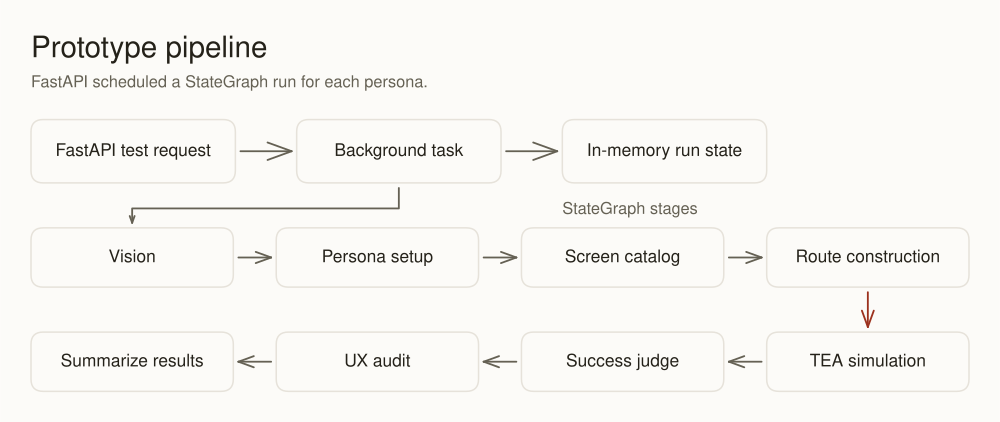
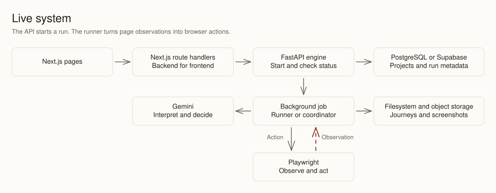
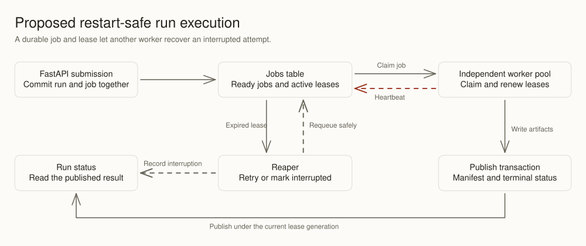
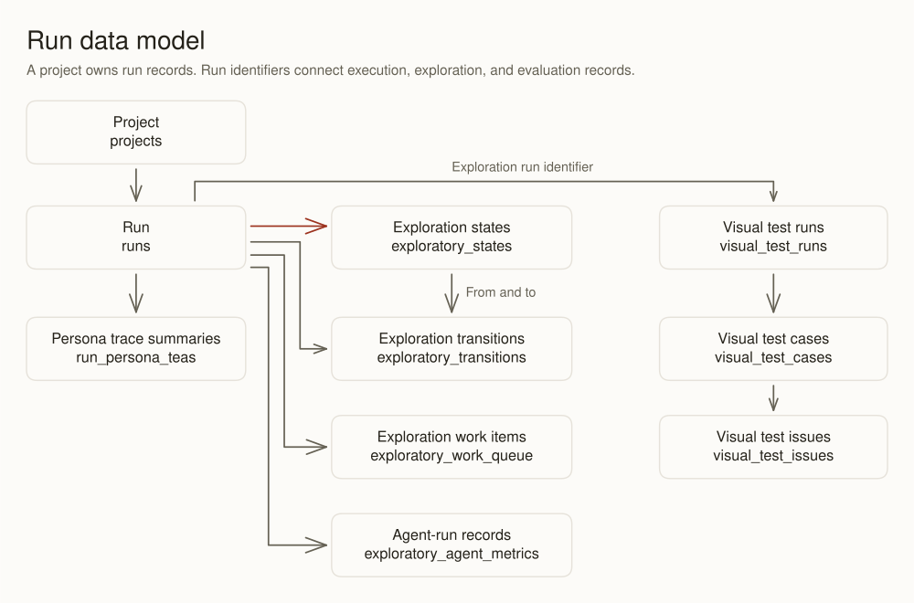

# System architecture

> [!NOTE]
> Sparrow turned prototype screenshots and live browser runs into journeys, reports, and supporting artifacts.<br>
> Follow the execution and storage paths, then see a proposed design for recovering interrupted runs.

## What a run needed to preserve

We built Sparrow to turn a product task into a journey someone could inspect. Design simulation needed to accept a set of screens, preserve persona behavior across turns, and produce a verdict and usability audit. Live testing added project setup, browser execution, progress, and artifacts that let someone trace a report back to an action or screen.

## Architecture and end-to-end flow

The prototype accepted images, tasks, and personas through FastAPI. A background job invoked a LangGraph StateGraph for each persona, and a status endpoint returned progress and results.

The pipeline parsed the screen inputs, initialized the persona, matched screen definitions, built a route map, and generated the TEA journey. A success judge and UX audit evaluated the journey before the final summary.

<picture>
  <source media="(prefers-color-scheme: dark)" srcset="../diagrams/prototype-pipeline-dark.svg">
  
</picture>

The prototype runs the screen-to-report pipeline for each persona in a background task.

[Editable: prototype-pipeline.excalidraw](../diagrams/prototype-pipeline.excalidraw)

The live system used Next.js pages and route handlers as a backend for frontend. FastAPI resolved the project, created a run record, scheduled execution, and returned a run identifier. The persona job started a Python subprocess.

The runner sent task context to Gemini, matched the resulting intent to the current page, executed it with Playwright, and observed the result. The exploratory path ran through an async coordinator with dedicated browser agents.

<picture>
  <source media="(prefers-color-scheme: dark)" srcset="../diagrams/live-system-dark.svg">
  
</picture>

Next.js starts a FastAPI job and retrieves the status and reports after execution.

[Editable: live-system.excalidraw](../diagrams/live-system.excalidraw)

## Deep dive: how runs survive restarts

### Where execution could stop

A run could stay marked in progress if the process stopped before it saved the final status.

FastAPI marked the run in progress before scheduling a background task. For live persona runs, the task launched a subprocess and used its exit status to decide what to record. For exploratory runs, the task waited for the coordinator inside the API process. It saved the outcome when the coordinator finished or raised an error.

Both paths stored status separately from execution. They tracked status and timestamps but lacked a heartbeat to show that a worker still owned the job. Another process had no expiry it could act on.

The saved row alone couldn’t tell the API whether the job was still running. **78 of 292 run records never reached a terminal status**, including internal test runs.[^status] The stored records show which runs were still in progress. They leave the cause of each case open.

### A durable execution design

A jobs table would let a worker pick up a run after the API restarts.

We'd save the run and its job in one database transaction, then return the run ID. An independent worker could see the job even if the API exited right after the transaction. The UI would keep reading the run record. The worker pool would limit how many browsers ran at once.

The job row would hold the run ID, execution mode, time the job could start, and number of attempts. It would also record which worker owned the job, when its lease expired, and the generation number of the claim.

<picture>
  <source media="(prefers-color-scheme: dark)" srcset="../diagrams/restart-safe-run-execution-dark.svg">
  
</picture>

The proposed design makes job ownership durable and gives expired attempts an explicit recovery path.

[Editable: restart-safe-run-execution.excalidraw](../diagrams/restart-safe-run-execution.excalidraw)

A worker would claim a ready job in a short database transaction. It would advance the generation number and set a deadline. Its heartbeat would extend the lease using database time as long as the worker still held that claim.

Before starting another step or publishing a result, the worker would check that it still held the lease. A cleanup process called a reaper would find expired leases and invalidate the old claims. It would either schedule another attempt or mark the run interrupted, depending on whether replay was safe and attempts remained.

A browser action might already have changed the app. In that case, marking the run interrupted would preserve the evidence for review.

<details>
<summary>Pseudocode</summary>

```text
submit: commit run and ready job together
worker: claim a ready job with a new lease generation
during execution: renew only while the current lease is valid
if ownership is lost: stop execution and release the browser
write artifacts under the attempt identifier
in one transaction, publish only if the worker still owns the lease
commit the final artifact manifest and terminal run and job status
reaper: invalidate each expired lease
requeue within the attempt budget when replay is safe
otherwise record an interrupted outcome
```

</details>

### Publish results idempotently

We'd make it safe to retry publication without saving a second result or letting a worker with an expired claim replace it.

Each attempt would write files under its own ID to keep workers from overwriting one another’s files. Once the files were ready, one database transaction would check the lease, attach the list of files to the run, and record the final status of the job and run.

If a worker missed the database response, it could look up the saved result for its claim generation. A stale attempt could leave files that no result refers to. Those files could be removed after a retention window.

Leases add heartbeat writes and a reaper to operate. A short lease frees capacity sooner and makes a retry more likely during a temporary stall. A long lease reduces that risk and makes interrupted work wait longer. We’d measure heartbeat delay and recovery time, then allow enough time for slow browser and model calls.

We'd first retry a safe run from the beginning. Resuming from a checkpoint would require evidence that the browser and app still matched the saved state.

## Persistence and reporting

We made the persona runner write journey steps and screenshots as it progressed, then assemble its structured report at the end. PostgreSQL and Supabase held project and run metadata. The engine served file-backed artifacts and supported Supabase object storage uploads for graph test artifacts.

Exploration stored states, transitions, queue claims, and agent metrics in the database. The UI fetched status, journeys, metrics, and PDF reports through route handlers. Its flow view used the state and transition graph from the engine.

### Data model

A project groups runs. The run identifier ties each exploration state, transition, queued action, and agent record back to the execution that produced it. A transition references the observed origin and destination within that run.

Persona trace summaries associate a run identifier with a persona identifier. A visual test run references its exploration run, test cases belong to the visual test run, and issue records belong to a case. This structure lets the reporting layer follow an issue back to the run that supplied the tested behavior.

<picture>
  <source media="(prefers-color-scheme: dark)" srcset="../diagrams/run-data-model-dark.svg">
  
</picture>

Run identifiers connect projects, persona records, exploration, and visual evaluation.

[Editable: run-data-model.excalidraw](../diagrams/run-data-model.excalidraw)

## Execution and storage choices

> [!IMPORTANT]
> Each execution path could evolve while the UI continued to identify work by run.

| Option | Pros | Cons | Decision |
|---|---|---|---|
| In-process prototype | Execution and status lived in the API process. | Progress was tied to that process. | Used for design simulation. |
| Persona subprocess | A subprocess ran the browser workflow. | The API background job still owned final status. | Used for live persona runs. |
| Coordinator and database queue | Several browsers worked against the same frontier. | The coordinator still ran inside the engine. | Used for exploratory runs. |

## Partial results and write failures

The prototype returned partial results when a single persona raised an exception. In the live persona path, the job continued after a metadata insert failed and reported through its local status file. The explorer required a database run identifier before starting because agents persisted observations and claimed work under that identifier.

## Boundaries of the original design

The prototype kept status in memory, so progress was tied to the serving process. The live engine held metadata in the database and saved local status and journey artifacts on disk. A deployment with separate API and worker hosts would need a shared artifact store for those files.

## What we'd do differently today

We'd introduce a durable queue, define explicit transitions for the job and task outcomes, and make result publication idempotent. We'd return artifact availability separately so readers know when a report is ready.

[^status]: Count of `runs` rows whose stored status was in progress, out of all rows in the table.

[← Previous](../README.md) · [README](../README.md) · [Next →](screen-understanding-and-navigation.md)
